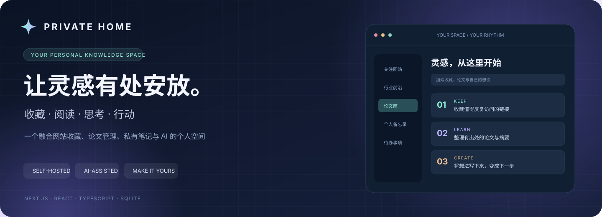
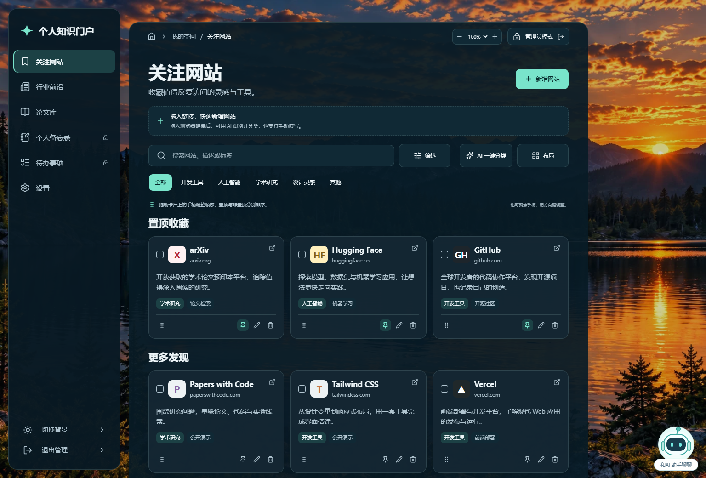
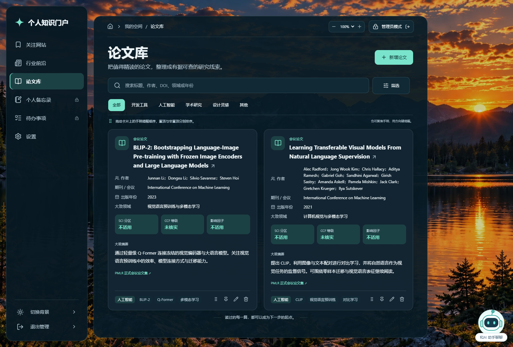
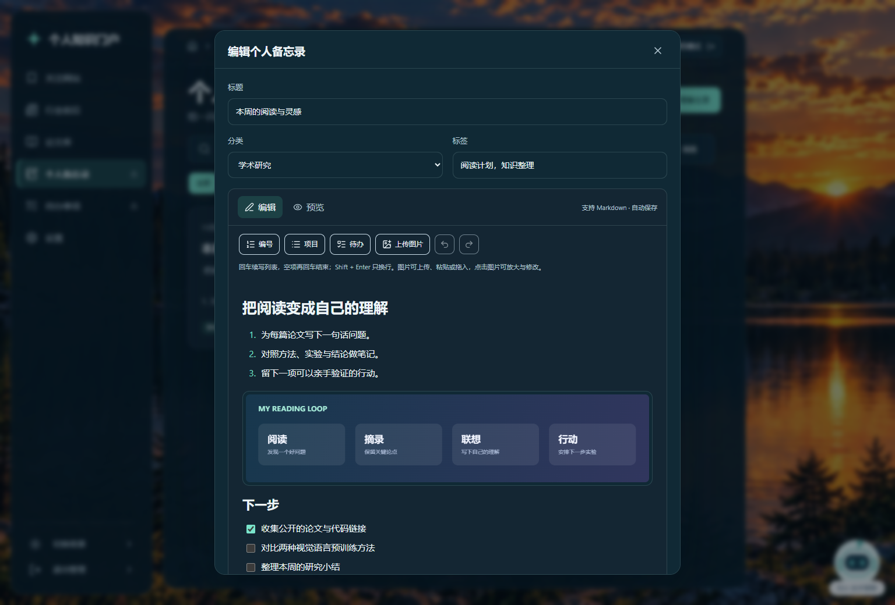
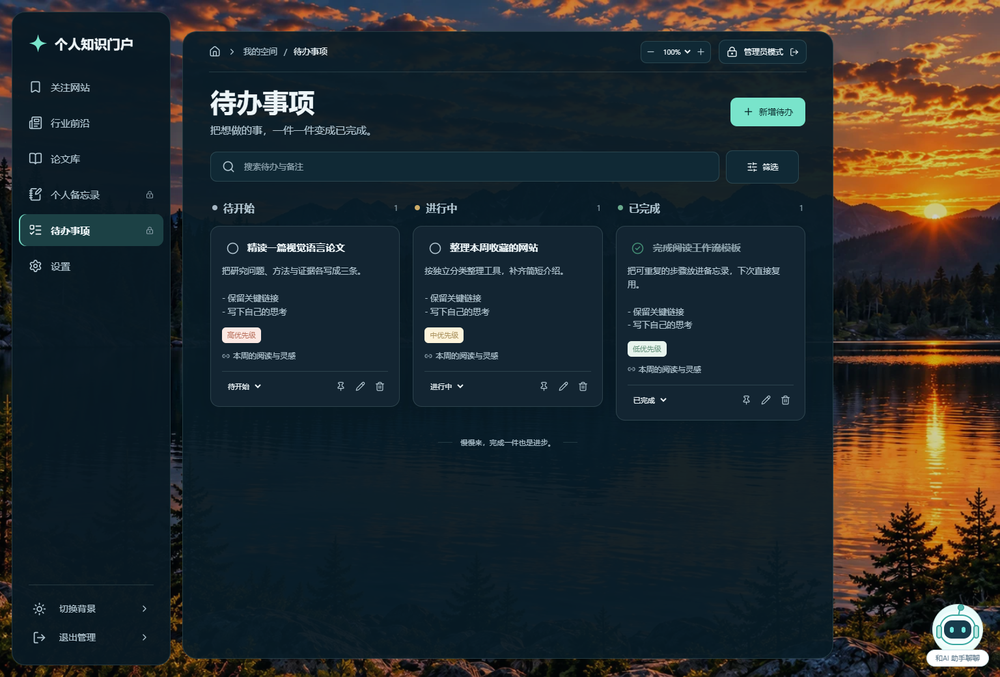
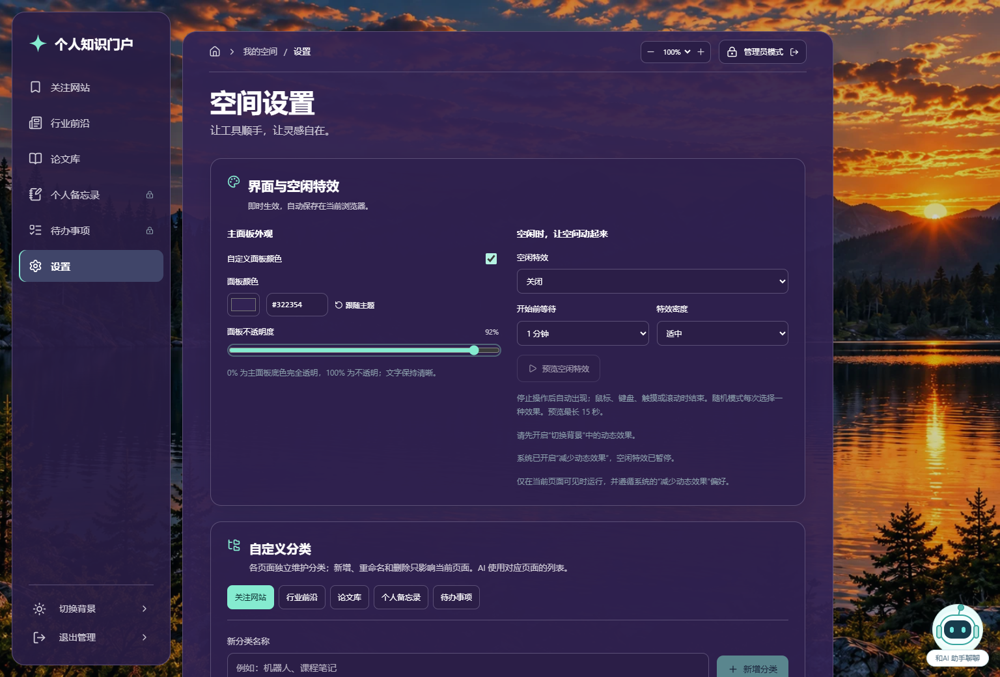
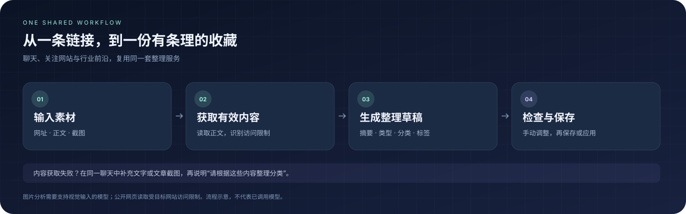
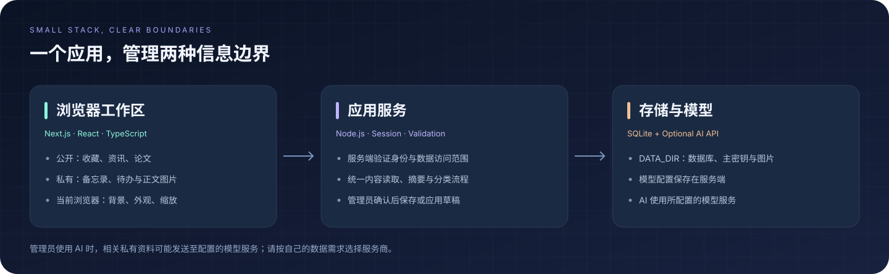

<div align="center">



# Private Home · 个人知识门户

**把喜欢的网站、值得读的论文和一闪而过的想法，整理进自己的空间。**

收藏与资讯 · 论文管理 · 图文备忘录 · 任务看板 · 可选 AI 助手

<p>
  
  
  
  
  
  
</p>

[功能一览](#features) · [界面预览](#showcase) · [AI 整理流程](#workflow) · [快速开始](#quick-start) · [部署到阿里云](docs/DEPLOY-ALIYUN.md)

</div>

---

浏览器收藏太零散，论文链接总是找不到，读过的内容又很难变成自己的笔记？Private Home 把这些环节串在一起：**收集链接 → 整理资料 → 记录思考 → 安排下一步行动**。

项目基于 Next.js、React、TypeScript 和 Node.js 内置 SQLite，支持自主部署。不配置 AI 也能使用收藏、论文手动录入、笔记和待办；接入自己的模型后，再开启摘要、分类与图片分析。

<a id="features"></a>

## ✨ 一个空间，五种整理方式

| 模块 | 可以做什么 | 顺手的细节 |
| :--- | :--- | :--- |
| 🔖 **关注网站** | 收藏常用工具、学习资料与灵感网站 | 链接拖入、搜索筛选、自定义分类、标签、卡片与列表布局 |
| 📰 **行业前沿** | 整理文章、公众号推文与研究动态 | 摘要与来源、AI 辅助分类、手动补充、按文章内容生成简写标识 |
| 📚 **论文库** | 汇集论文书目信息与阅读线索 | 作者、正式出处、出版年份、领域、摘要，以及带年份与来源的 SCI / CCF / 影响因子 |
| 📝 **个人备忘录** | 写下想法、阅读笔记与工作记录 | 可视化图文编辑、列表自动续写、正文图片、图片放大与排版、自动保存 |
| ✅ **待办事项** | 把想法落到具体步骤 | 待办 / 进行中 / 已完成看板，优先级、截止日期、关联记录与图文备注 |

**整理方式由你决定。** 关注网站、行业前沿和论文库的分类与标签相互独立。管理员可以管理分类，在置顶组和非置顶组内分别拖拽排序，也可使用键盘调整卡片顺序。

<a id="showcase"></a>

## 🖼️ 看看它的样子

以下为公开源码在独立演示环境中的实际截图，仅使用公开资料与专门编写的示例笔记；不含原站的私人内容、账号、连接信息或模型配置。封面与流程图为说明性设计。

### 清晰的工作区，也可以有自己的风景

[](docs/images/overview.png)

<table>
  <tr>
    <td width="50%" valign="top">
      <h3>📚 有出处的论文卡片</h3>
      <a href="docs/images/papers.png"></a>
      <p>把标题、作者、会议与摘要放在一起。指标缺少依据时显示“未核实”，保留进一步查证的空间。</p>
    </td>
    <td width="50%" valign="top">
      <h3>📝 图片就在笔记正文里</h3>
      <a href="docs/images/memo.png"></a>
      <p>上传、粘贴或拖入图片；点击查看大图、替换图片，并调整正文显示宽度、对齐与说明。</p>
    </td>
  </tr>
  <tr>
    <td width="50%" valign="top">
      <h3>✅ 从计划到已完成</h3>
      <a href="docs/images/tasks.png"></a>
      <p>用状态列跟进任务，关联笔记与资料，在备注里保留步骤和参考图。</p>
    </td>
    <td width="50%" valign="top">
      <h3>🎨 让界面适合自己</h3>
      <a href="docs/images/appearance.png"></a>
      <p>面板颜色与透明度自由调整；支持背景、80%～120% 页面缩放和空闲特效，在当前浏览器记住选择。</p>
    </td>
  </tr>
</table>

> 点击图片可以查看原图。演示论文书目信息来自公开的 [CLIP](https://proceedings.mlr.press/v139/radford21a.html) 与 [BLIP-2](https://proceedings.mlr.press/v202/li23q.html) 会议页面；截图为人工准备的展示数据，未调用真实模型服务。[图片说明与制作方式 →](docs/images/README.md)

<a id="workflow"></a>

## 🪄 AI 整理：从素材到可以检查的草稿



聊天框、关注网站和行业前沿的 AI 辅助分类入口，复用同一套内容整理服务。你可以直接用自然语言说明意图：

```text
帮我整理这个网站，生成简介和合适的分类：<网站链接>

这是我关注的一篇文章，请总结要点并归入行业前沿：<文章链接>

这个公众号链接打不开，请根据我补充的截图整理摘要和标签。

总结一下论文库中关于视觉语言预训练的资料，并比较主要方法。
```

1. **提供素材**：发送链接，粘贴文章内容，或导入截图并说明想做什么。
2. **获取内容**：读取可访问的公开网页；遇到验证页或访问限制时，补充文字或截图。
3. **生成草稿**：识别内容类型，建议标题、摘要、分类和标签；结合当前身份允许访问的站内资料回答。
4. **检查结果**：确认内容与分类，可手动调整，再保存到对应模块或应用分类结果。

AI 不会通过聊天直接修改或删除已有记录。批量分类支持最多 10 条以及撤销；模型生成的内容仍需要结合原始来源判断。

### 论文导入不止一种入口

| 你手里的材料 | 如何使用 |
| :--- | :--- |
| **论文网址 / DOI** | 在“新增论文”中输入链接或 DOI，读取书目信息并生成可编辑草稿 |
| **只有论文名称** | 输入名称检索候选，选择匹配论文后继续整理 |
| **PDF / DOCX / TXT / Markdown** | 导入文件，提取可用文本；扫描件或无法提取文字的材料可补充截图 |
| **BibTeX / RIS / ENW / JSON** | 导入文献记录，补齐作者、出处与其他元数据 |
| **论文或文章截图** | 导入图片作为辅助素材；图片分析需要所选模型支持视觉输入 |

**出处与指标有各自的依据。** 论文会优先寻找正式期刊或会议记录，预印本与正式发表状态分别展示；SCI 分区、CCF 等级和影响因子记录相应年份与来源，无法核实的内容保留“未核实”。公众号验证页、登录限制与付费全文不能靠更换提示词保证读取成功。

<details>
<summary><strong>⌨️ 图文编辑与个性化的小细节</strong></summary>

- 编号、项目符号与待办列表：按 Enter 自动续写，空项再按 Enter 退出；Shift + Enter 仅换行。
- 图片：支持上传、粘贴和拖入；点击图片放大、替换、修改说明、调整宽度与对齐。
- 外观：自定义面板颜色与透明度，选择内置背景或导入自己的背景。
- 空闲效果：落花、下雨、下雪、流星、气泡与随机模式；恢复操作后结束，并遵循系统“减少动态效果”偏好。
- 浏览器偏好：背景、页面缩放与外观选择保存在当前浏览器；不等同于账号之间的同步设置。

</details>

<a id="quick-start"></a>

## 🚀 从本地开始

需要 **Node.js 24+、npm 和 Git**。下面以 Windows / PowerShell 为例：

```powershell
git clone https://github.com/ljtyyds/private-home.git
cd private-home
npm ci
Copy-Item .env.example .env.local
npm run dev
```

macOS / Linux 将复制配置文件的命令替换为 `cp .env.example .env.local`。

打开 **http://127.0.0.1:3000**，即可浏览演示收藏。首次进入管理员模式：

1. 点击“管理员登录”。
2. 从自己本机的 `data/setup-token.txt` 读取初始化码；自定义 `DATA_DIR` 时，在对应目录中查找。
3. 创建自己的管理员用户名和密码，进入管理工作区。没有预设的通用账号或密码。

也可以运行 `npm run setup` 完成交互式初始化。初始化码、密码和生成的数据文件均由部署者私下保管。

### 接入你自己的 AI 服务

进入 **设置 → 连接你的 AI 助手**，填写兼容 Chat Completions 的 API 基础地址、模型 ID 和 API Key，先保存，再测试已保存的连接。仓库不附带可用密钥或原站模型配置。

| 配置项 | 作用 |
| :--- | :--- |
| `AI_BASE_URL` | 服务商提供的兼容接口基础地址 |
| `AI_MODEL` | 服务商支持的实际模型 ID |
| `AI_API_KEY` | 自己的 API 密钥，仅在服务端使用 |
| `DATA_DIR` | 持久化数据目录，默认 `./data`，不能放在 `public/` 下 |
| `APP_ORIGIN` / `COOKIE_SECURE` | 部署访问地址与 Cookie 设置，按本地、隧道或 HTTPS 场景配置 |

也可通过环境变量配置模型；环境变量优先于设置界面。更换服务商时需要保存对应密钥。连接测试成功后，再用实际的聊天、分类或图片任务确认所选模型的能力。

## 🧭 结构与数据边界



| 目录 | 内容 |
| :--- | :--- |
| [`app/`](app/) | 页面入口、API 路由与全局样式 |
| [`components/`](components/) | 工作区、AI 对话、各类编辑器与外观控件 |
| [`server/`](server/) | 数据访问、身份验证、模型传输、内容读取与论文服务 |
| [`shared/`](shared/) | 数据类型、内容解析、排序与编辑规则 |
| [`tests/`](tests/) / [`e2e/`](e2e/) | 单元与后端测试、浏览器交互测试 |
| [`deploy/`](deploy/) / [`docs/`](docs/) | 通用部署模板、连接教程与说明图片 |

- **读者与管理员分开**：读者可浏览公开的网站、资讯和论文；备忘录、待办及正文图片仅管理员可访问。读者 AI 对话可由管理员选择开放，只检索允许公开的资料。
- **数据与源码分开**：数据库、上传图片、主密钥、初始化码、实际模型设置和 `.env.local` 不随源码发布。此仓库不提供原站的内部记录或账号。
- **模型服务是独立的处理方**：管理员使用 AI 时，相关私有记录可能发送至配置的模型服务；请选择自己信任的服务商。
- **浏览器背景留在浏览器**：本地导入的背景与当前浏览器偏好不随 Git 仓库分发。

## ☁️ 部署与日常维护

从单机运行到阿里云 ECS，可沿着同一条路径继续：

**本地运行 → 初始化管理员 → 配置持久化目录 → 生产构建 → 启动服务 → 按部署场景配置访问 → 定期备份。**

完整步骤见 **[阿里云连接与部署教程](docs/DEPLOY-ALIYUN.md)**，包含：

- 当前公网出口查询与安全组来源设置。
- `Test-NetConnection` 端口测试、SSH 登录和 SSH 隧道访问。
- HTTPS / 隧道场景的配置、服务排错、数据备份与回滚。

教程与部署模板均使用通用占位符。实际服务器地址、域名、账号、私钥和模型配置由部署者私下填写与保管。

## 🛠️ 开发与验证

```powershell
npm run typecheck   # TypeScript 检查
npm test            # 核心测试（tests/core.test.ts）
npm run build       # 生产构建
```

运行全部单元与后端测试：

```powershell
$testFiles = Get-ChildItem tests -Filter '*.test.ts' | ForEach-Object FullName
node --import tsx --test --test-concurrency=1 $testFiles
```

浏览器测试使用隔离数据目录。设置 `CHROME_PATH` 为自己安装的 Chromium、Chrome 或夸克可执行文件路径后，运行 `npm run test:e2e`；报告与测试数据应保存在忽略目录中。

<details>
<summary><strong>💬 常见问题</strong></summary>

**不配置模型，能先用吗？** 可以。网站收藏、手动录入、备忘录、待办与外观设置可独立使用，AI 功能需要另行接入。

**公众号链接读不到怎么办？** 先确认原文在自己的浏览器中可以打开；遇到验证页时，向助手补充正文或清晰截图，再说明要总结还是分类。

**为什么论文指标显示“未核实”？** 指标需要匹配正式出处、年度和来源。没有足够证据时保留未知状态，避免把预印本记录或无来源数字当成正式指标。

**其他人部署后会看到我的原站内容吗？** 不会。仓库仅包含通用源码与演示资料，新部署创建自己的数据目录和账号。

**图片展示的内容从哪里来？** 截图来自隔离的演示实例，使用公开论文信息和专门编写的示例笔记；不代表真实模型服务的测试结果。

</details>

---

<div align="center">

**给信息一个位置，给思考留一点空间。**

[开始使用](#quick-start) · [阅读部署教程](docs/DEPLOY-ALIYUN.md) · [反馈问题](https://github.com/ljtyyds/private-home/issues)

<sub>第三方 PDF 组件的许可证与声明保留在 <a href="vendor/pdfjs/NOTICE.md">vendor/pdfjs</a>。</sub>

</div>
